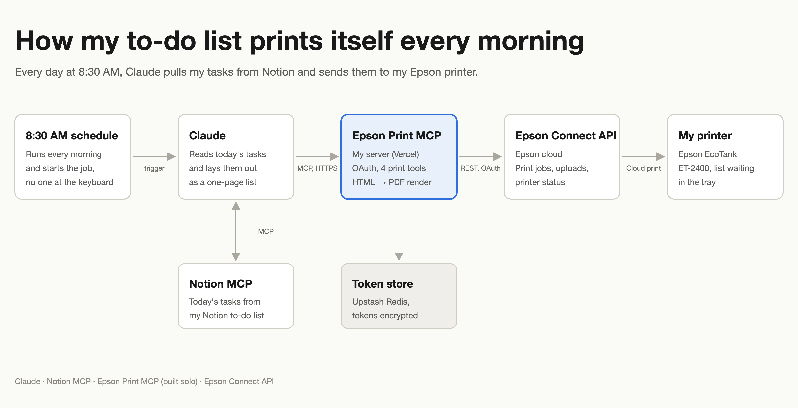

# Epson Print MCP

Print from Claude (and other AI apps) on your own Epson printer. Ask "print my to-do list" and it comes out of your printer, laid out and ready to use.

**Server URL:** `https://epson-mcp-server.vercel.app/api/mcp`

It's a remote [MCP](https://modelcontextprotocol.io) server. You add the URL once and sign in with your Epson Connect account. From then on, Claude can check your printer, choose paper and quality, print documents and follow each job until the page is in the tray.

> Independent project. Not made, endorsed or supported by Epson.



## Contents

- [What you need](#what-you-need)
- [Set it up](#set-it-up)
  - [Claude (web, desktop and mobile)](#claude-web-desktop-and-mobile)
  - [Claude Code](#claude-code)
  - [Other AI apps](#other-ai-apps)
- [Connecting your printer (first use)](#connecting-your-printer-first-use)
- [What to ask for](#what-to-ask-for)
- [Tools](#tools)
- [Print settings](#print-settings)
- [What it can print](#what-it-can-print)
- [Limits and safety checks](#limits-and-safety-checks)
- [Business print kits](#business-print-kits)
- [Example: print your to-do list every morning](#example-print-your-to-do-list-every-morning)
- [Troubleshooting](#troubleshooting)
- [Privacy and security](#privacy-and-security)
- [Disconnecting](#disconnecting)
- [Run your own copy](#run-your-own-copy)

## What you need

1. **An Epson printer that supports Epson Connect.** Most recent Epson inkjets do, including EcoTank models such as the ET-2400.
2. **An Epson Connect account with the printer registered to it.** If you haven't set it up yet, follow Epson's instructions at [epsonconnect.com](https://www.epsonconnect.com). If you can already print to it from Epson's app or by email, you're ready.
3. **An AI app that supports remote MCP servers with OAuth sign-in**, such as Claude.

The printer only needs to be on and online. It doesn't have to be on the same network as you, because jobs go through Epson's cloud.

## Set it up

### Claude (web, desktop and mobile)

You add the connector once, on claude.ai or in Claude Desktop. It then works in Claude Desktop and the Claude mobile apps too.

1. Open [claude.ai](https://claude.ai), or the Claude Desktop app.
2. Click **Customize**, then select **Connectors**.
3. At the top right, click **Add**, then choose **Add custom connector**.
4. Enter:
   - **Name:** `Epson Print`
   - **URL:** `https://epson-mcp-server.vercel.app/api/mcp`
5. Click **Add**, then **Connect**. Claude opens the sign-in flow described in [Connecting your printer](#connecting-your-printer-first-use).
6. In a chat, make sure the connector is switched on in the tools menu, then ask Claude to print something.

> On Team and Enterprise plans, an owner may need to allow custom connectors first.

### Claude Code

```bash
claude mcp add --transport http epson-print https://epson-mcp-server.vercel.app/api/mcp
```

Then, inside Claude Code, run `/mcp`, select **epson-print** and choose **Authenticate**. Your browser opens the Epson sign-in.

Add `--scope user` to the command to make the server available in all your projects, not just the current one.

### Other AI apps

The server follows the standard MCP authorization flow (OAuth 2.1 with dynamic client registration and PKCE). Any app that supports remote MCP servers over Streamable HTTP with OAuth should be able to connect. Claude is the one that has been tested.

**Cursor** — add to `~/.cursor/mcp.json`:

```json
{
  "mcpServers": {
    "epson-print": { "url": "https://epson-mcp-server.vercel.app/api/mcp" }
  }
}
```

**VS Code (GitHub Copilot)** — add to `.vscode/mcp.json`:

```json
{
  "servers": {
    "epson-print": { "type": "http", "url": "https://epson-mcp-server.vercel.app/api/mcp" }
  }
}
```

**Anything else:** look for "add MCP server", "custom connector" or "remote server" in the app's settings and paste the URL. The app should open a browser window to sign in the first time it uses a tool.

## Connecting your printer (first use)

The first time you connect, you'll go through three short screens:

1. **"Connect your Epson printer"** — a page on this server that names the app asking for access and lists what it will be able to do: check whether your printer is online, read its paper and quality options, and send print jobs and follow their status. Click **Continue to Epson**.
2. **Epson's own sign-in page** — sign in with your Epson Connect account and choose the printer. Your Epson password goes to Epson only; this server never sees it.
3. **Back to your app** — you're returned to Claude (or whichever app you used), and the connector shows as connected.

To check it worked, ask: *"Is my printer online?"*

You stay signed in. The app's access token renews itself automatically, so you won't need to sign in again unless you stop using it for more than 30 days or remove the connector.

## What to ask for

Talk normally. Claude picks the layout, the paper and the settings. Some examples:

- "Print my to-do list for today."
- "Print this recipe on one A4 page, black and white."
- "Make a sign for the front door: 'Back in 15 minutes'. Big letters, Letter paper, landscape."
- "Print 3 copies of this worksheet in draft quality."
- "Print this photo borderless on 4x6 photo paper."
- "Is my printer online? What paper sizes does it take?"
- "Did my last print finish?"

Claude will normally confirm before printing, because it uses real paper and ink. After printing, it can wait and tell you when the job is done, or tell you why it stopped (out of paper, paper jam, out of ink).

## Tools

The server gives the AI app four tools:

| Tool | What it does |
|---|---|
| `get_printer_status` | Shows which printer is connected, its model and whether it's online. |
| `get_print_options` | Lists what the printer supports: paper sizes, paper types, qualities, colour modes, paper trays, and its defaults. Takes a `mode` of `document` or `photo`. |
| `print_document` | Prints Markdown, HTML, or a PDF, JPEG or PNG file. All settings are optional. Returns a job ID. |
| `get_print_job_status` | Says where a job is: waiting, printing, paused (with the reason), printed or canceled. Can wait up to 50 seconds for it to finish, with live progress updates. |

## Print settings

Every setting is optional and takes everyday words. Anything you leave out uses the printer's own default.

| Setting | Examples | Notes |
|---|---|---|
| `paper_size` | `A4`, `Letter`, `4x6` | The page layout is sized to match automatically. |
| `paper_type` | `plain`, `photo paper`, `matte` | |
| `quality` | `draft`, `normal`, `high` | |
| `color` | `color`, `black and white` | |
| `mode` | `document`, `photo` | Defaults to `document` for text and PDFs, `photo` for images. |
| `paper_source` | `rear` | Paper tray, if the printer has more than one. |
| `borderless` | `true` / `false` | Only on paper sizes and types that support it. |
| `copies` | `1`–`10` | Default 1. |

Ask *"What print options does my printer have?"* to see exactly what yours supports.

## What it can print

| Source | Best for | Details |
|---|---|---|
| **Markdown** | Lists, notes, letters, simple documents | Headings, bullet and task lists, tables, quotes and code blocks. Turned into a PDF on the server. Uses standard PDF fonts, so emoji and some special characters may print as `?`. Ask for HTML if you need them. |
| **HTML** | Anything where layout matters: menus, labels, price tags, signs, certificates, flyers, forms | Rendered with a real browser engine (Chromium), so full CSS works. Images and fonts load from public `https` URLs or `data:` URLs. JavaScript doesn't run. |
| **PDF, JPEG, PNG** | Files the AI app has the actual bytes of | Sent base64-encoded, up to 1 MB. |

**Attachments in chat:** when you share a PDF or image in chat, the AI app can usually read it but doesn't pass the original file to the server. In that case Claude recreates it as HTML, keeping the text exactly as written and matching the layout as closely as it can, and tells you that it printed a recreation, not the original file.

## Limits and safety checks

- **Confirm before big jobs:** anything over 30 printed pages (pages × copies) is refused until you confirm. Claude asks you first.
- **Copies:** 1 to 10 per job.
- **Rate limit:** at most 20 print jobs per hour for each printer connection.
- **File size:** PDF, JPEG and PNG files up to 1 MB.
- **Cancel:** there's no cancel tool yet. To stop a job, cancel it on the printer.
- **Shared Epson quota:** all users share one Epson developer app, so Epson's own limits apply on top of these.

## Business print kits

[`plugins/`](plugins/README.md) has ready-made Claude plugins that bundle this connector with a skill and tested layouts for a type of business:

| Plugin | Prints |
|---|---|
| `epson-restaurant` | Menus, table tents, specials boards, allergen cards, prep labels |
| `epson-school` | Worksheets with answer keys, certificates, attendance registers, name tags, flashcards |

Install them in Claude Code from a copy of this repo:

```bash
git clone https://github.com/shubham-0921/epson-mcp.git
```

```bash
claude plugin marketplace add ./epson-mcp/plugins
```

```bash
claude plugin install epson-restaurant@epson-print
```

In claude.ai or Claude Desktop, add the connector as above, then upload the skill folder (zipped) under **Settings → Capabilities → Skills**, for example `plugins/epson-restaurant/skills/restaurant-printing`. See [plugins/README.md](plugins/README.md) for details.

## Example: print your to-do list every morning

The diagram at the top shows this setup. Connect both the **Notion** connector and **Epson Print**, then use a prompt like this:

> Get my tasks due today from my Notion to-do list. Print them as a one-page checklist on Letter paper, in black and white, with today's date at the top and a checkbox next to each task. Group them by priority.

Run it on a schedule (for example, every day at 8:30 AM) with a scheduled task in the Claude desktop app or Claude Code, and the list is waiting in the printer tray when you sit down.

The same pattern works with any connector that holds information: your calendar for a daily agenda, email for a reading list, or a spreadsheet for a stock-count sheet.

## Troubleshooting

| Problem | What to do |
|---|---|
| The app says the connector needs authentication | Reconnect it. In Claude: **Customize → Connectors → Epson Print → Connect**. In Claude Code: `/mcp` → **epson-print** → **Authenticate**. |
| "Printer is offline" | Check the printer is on and connected to Wi-Fi, and that you can print to it from Epson's own app. |
| The job is paused | Ask "Why did my print stop?" It will report the reason, for example out of paper, a paper jam or out of ink. Fix it on the printer and the job should carry on. |
| I chose the wrong printer at sign-in | Remove the connector, add it again, and pick the right printer on Epson's page. |
| "Print limit reached" | You've sent 20 jobs in the last hour. Wait a while and try again. |
| The layout is off | Ask for the paper size you actually have loaded ("use A4"), or ask Claude to "use HTML for an exact layout". |
| Emoji or special characters print as `?` | Ask Claude to print it as HTML instead of Markdown. |
| A shared PDF printed as a recreation | That's expected when the app can't pass the file itself. For an exact copy, print the original file from your computer. |

## Privacy and security

- **Your Epson password** is entered on Epson's site only. This server never sees it.
- **Epson access tokens** are stored encrypted (AES-256-GCM). The tokens given to your AI app are stored only as SHA-256 hashes. App access tokens last 1 hour and refresh tokens 30 days; each refresh token works once and is replaced on use.
- **Your documents** are converted to PDF if needed and sent straight to Epson Connect. They aren't kept on this server.
- **Usage analytics** count tool calls, pages, paper sizes and which AI app was used, so I can see how the server is used. They never include document content, titles, printer serial numbers or tokens.

## Disconnecting

Remove the connector in your AI app (in Claude: **Customize → Connectors → Epson Print → Remove**; in Claude Code: `claude mcp remove epson-print`). Once the app stops refreshing its token, access lapses: app tokens expire within 30 days and the stored Epson connection within 60 days.

## Run your own copy

The server is a Next.js app that deploys to Vercel with Upstash Redis. It needs your own Epson Connect developer credentials. There's also a local stdio version for Claude Desktop, and a web console that shows every Epson Connect API call live.

See [docs/DEVELOPMENT.md](docs/DEVELOPMENT.md) for setup, environment variables, architecture and tests.
